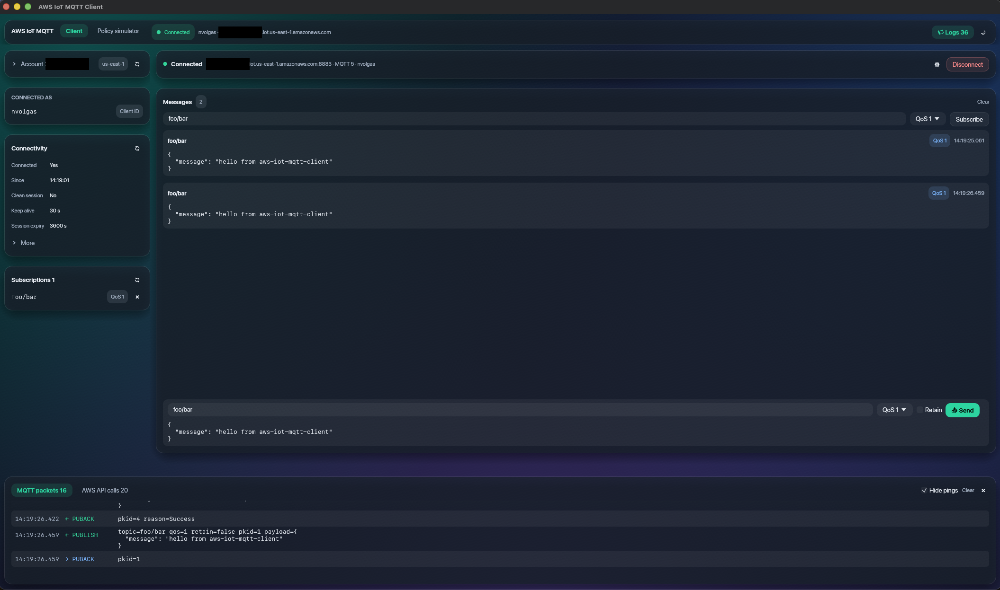

# AWS IoT MQTT Client

[](https://github.com/volnix/aws-iot-mqtt-client/actions/workflows/ci.yml)
[](https://codecov.io/gh/volnix/aws-iot-mqtt-client)
[](https://github.com/volnix/aws-iot-mqtt-client/releases/latest)
[](https://github.com/volnix/aws-iot-mqtt-client/releases)
[](#download-and-install)
[](DEVELOPMENT.md#build-from-source)
[](https://deps.rs/repo/github/volnix/aws-iot-mqtt-client)
[](LICENSE)
[](https://www.buymeacoffee.com/volnix)



A desktop app for connecting to AWS IoT Core as a device, publishing and subscribing to MQTT
topics, and checking whether an IoT policy allows what a device is trying to do. It runs on
macOS, Windows, and Linux.

## Features

**Connect as a device**

- Sign in with any AWS profile, including SSO. The app finds your account's IoT endpoint and
  Things for you.
- Connect as one of your Things, or as any client ID you choose.
- Pick the account's default endpoint or one of your custom domains.
- Use MQTT 5 or MQTT 3.1.1, with clean or persistent sessions, session expiry, and a last will
  message.
- With MQTT 5, add User Properties to CONNECT, the last will, PUBLISH, SUBSCRIBE, and
  UNSUBSCRIBE. Properties on received messages and broker packets are shown too.

**Publish, subscribe, and watch**

- Subscribe to topic filters and see incoming messages as they arrive.
- Publish with QoS 0 or 1 and the retain flag.
- While connected, see the broker's view of your connection: connection time, session
  settings, and every active subscription, each with an unsubscribe button.

**Work with Device Shadows**

- When you connect as a Thing, its classic and named shadows load automatically.
- The **Shadows** tab shows each shadow's desired, reported, and delta state, with its version.
- Update the desired or reported state, or create a new named shadow, as the device would.

**Create certificates in one step**

- Create a certificate and key for a Thing or client ID without leaving the app.
- Attach an existing policy, or create a new one from a best-practice template that you can
  edit first.
- The new certificate is attached and loaded automatically, so you can connect right away.

**Simulate IoT policies**

- Paste a policy, or load one from your account.
- Pick an MQTT operation (CONNECT, PUBLISH, SUBSCRIBE, or receiving a message) and see
  **Accept** or **Reject**, with the statement that decided it.
- It runs entirely on your machine and updates as you type.

**Take it to the command line**

- In the MQTT log, copy any PUBLISH or SUBSCRIBE you sent as a ready-to-run `mosquitto_pub` or
  `mosquitto_sub` command, for macOS/Linux shells or PowerShell. It uses the same endpoint,
  client ID, protocol settings, and certificate files.

**Make it yours**

- A minimal frosted-glass look in light or dark, with adjustable window transparency. The
  desktop shows through blurred on macOS and Windows 11.
- Choose where created certificates are saved.
- Turn the MQTT log, the AWS API log, or both off. Nothing is recorded while a log is off, and
  with both off the Logs button disappears.

**See everything it does**

- A packet log shows every MQTT packet sent and received. Export it as JSON or text to share a
  trace.
- An API log shows every AWS call, with timing and request IDs. Secrets are never logged.

## Download and install

Download the latest build for your system from the
[Releases page](https://github.com/volnix/aws-iot-mqtt-client/releases):

| System | File |
| --- | --- |
| macOS (Apple silicon and Intel) | `aws-iot-mqtt-client-<version>-macos-universal.dmg` (or `.zip`) |
| Windows | `aws-iot-mqtt-client-<version>-windows-x86_64.zip` |
| Linux (Intel/AMD) | `aws-iot-mqtt-client-<version>-linux-x86_64.tar.gz` |
| Linux (ARM) | `aws-iot-mqtt-client-<version>-linux-arm64.tar.gz` |

- **macOS:** open the `.dmg` and drag **AWS IoT MQTT Client** to **Applications**. Releases are
  signed with a Developer ID and notarized by Apple, so it opens like any other app. If macOS
  says it can't verify the app (older, unsigned builds), open **System Settings → Privacy &
  Security** and click **Open Anyway**.
- **Windows:** unzip and run `aws-iot-mqtt-client.exe`. If SmartScreen appears, choose
  **More info → Run anyway**.
- **Linux:** extract and run `./aws-iot-mqtt-client`. It needs a desktop session (X11 or
  Wayland) with OpenGL, which standard desktop installs include.

To verify a download, compare it with the checksums in `SHA256SUMS` on the release page.

## Getting started

1. **Load your account.** Choose an AWS profile and region in **Settings** (⚙ in the rail on
   the left), then click **Load from AWS**. For an SSO profile, run
   `aws sso login --profile <name>` first.
2. **Choose who to connect as.** Select a Thing, or switch to **Client ID** and type one.
3. **Add a certificate.** Choose the device's certificate and private key files, or click
   **Create certificate** to make new ones.
4. **Connect.** The connection settings collapse once you're connected, and the message view
   takes over. Subscribe to a topic filter at the top, and publish from the composer at the
   bottom.

The rail on the left switches between **Client**, **Shadows**, and **Policy simulator**.
**Logs** opens the packet and API logs, and **Settings** holds the AWS profile, where
certificates are saved, the theme, window transparency, and which logs are recorded.

## Permissions

The app uses your AWS credentials to look things up, and only changes your account when you
click **Create certificate**.

<details>
<summary>IAM permissions the app uses</summary>

To browse your account and connect (read-only):

```
iot:DescribeEndpoint, iot:ListThings, iot:DescribeThing,
iot:ListDomainConfigurations, iot:DescribeDomainConfiguration,
iot:GetConnection, iot:ListSubscriptions, iot:ListNamedShadowsForThing
```

Without the domain configuration permissions, only the default endpoint is listed.
`iot:GetConnection`, `iot:ListSubscriptions`, and `iot:ListNamedShadowsForThing` are only used
while connected. Shadow reads and updates go over MQTT as the device, so they need the
device's policy to allow its `$aws/things/<thing>/shadow/` topics. The app's default policy
allows them.

To create certificates, and to load policies into the simulator:

```
iot:ListPolicies, iot:GetPolicy, iot:CreateKeysAndCertificate, iot:AttachPolicy,
iot:AttachThingPrincipal, iot:CreatePolicy (only when creating a new policy)
```

Loading from AWS is optional: you can also type an endpoint and client ID by hand.

</details>

## If the connection closes right away

AWS IoT closes the connection without a reason when the certificate isn't active, or its policy
doesn't allow `iot:Connect` for the client ID you're using. Use the **Policy simulator** tab to
check the policy against your client ID. A typical device policy allows connecting only as the
Thing it's attached to:

```json
{
  "Effect": "Allow",
  "Action": "iot:Connect",
  "Resource": "arn:aws:iot:REGION:ACCOUNT:client/${iot:Connection.Thing.ThingName}",
  "Condition": { "Bool": { "iot:Connection.Thing.IsAttached": "true" } }
}
```

That policy only works when the client ID equals the Thing name and the certificate is attached
to that Thing.

## More about the features

<details>
<summary>Creating a certificate</summary>

**Create certificate** appears under the selected Thing, or under the client ID in Client ID
mode. In the dialog you can:

- **Create a new policy.** It's prefilled from a best-practice template that you can edit before
  it's created.
  - For a Thing, it follows the AWS
    [thing policy best practice](https://docs.aws.amazon.com/iot/latest/developerguide/thing-policy-examples.html):
    connecting is allowed only with a client ID equal to the Thing name, and only while the
    certificate is attached to it.
  - For a client ID, connecting is allowed only as that client ID.
  - Both allow publishing, subscribing, and receiving on all topics.
- **Attach an existing policy** from your account.

The dialog lists the exact changes before anything runs. When you confirm, it:

1. Creates the policy, if it's new. This runs first, so a problem with the policy stops
   everything before a certificate exists.
2. Creates a key pair and an active certificate.
3. Saves the certificate and keys in the app's cache folder. That's `~/Library/Caches` on
   macOS, `~/.cache` on Linux, or `%LOCALAPPDATA%` on Windows, under
   `aws-iot-mqtt-client/certificates/`. On macOS and Linux only you can read the folder.
4. Attaches the policy to the certificate, and the certificate to the Thing.

If a step fails, the dialog shows which steps finished. Nothing is rolled back, and the saved
key stays loaded, because AWS returns a private key only once.

</details>

<details>
<summary>How the policy simulator decides</summary>

| Operation | Checked as | Resource |
| --- | --- | --- |
| CONNECT | `iot:Connect` | `client/<client ID>` |
| PUBLISH | `iot:Publish`, plus `iot:RetainPublish` when retained | `topic/<topic>` |
| SUBSCRIBE | `iot:Subscribe` | `topicfilter/<filter>` |
| Receive (a message the broker delivers) | `iot:Receive` | `topic/<topic>` |

UNSUBSCRIBE isn't listed because IoT policies have no action for it.

Evaluation follows AWS IoT's rules:

- **Allow and Deny:** an explicit `Deny` wins. Otherwise an `Allow` is required; with neither,
  the request is denied.
- **Wildcards:** `*` and `?` are wildcards. MQTT's `+` and `#` are ordinary characters in
  policies.
- **Case:** actions are case-insensitive; resources are case-sensitive.
- **Policy variables:** `${iot:ClientId}`, the Thing variables, and any you add are filled in.
  - Thing variables only have a value when the certificate is attached to the Thing and the
    client ID equals its name, unless the attachment is exclusive.
  - A statement that needs a variable with no value doesn't match. The result lists which
    variables were missing.
- **Supported elements:** `NotAction` and `NotResource`, and the `String`, `Arn`, `Bool`,
  `Null`, and `IpAddress` condition operators, including `…IfExists`.
- **Everything else:** other condition operators aren't evaluated. If one could change the
  outcome, the result says **Not certain** rather than guessing.

Fill in the **Connection context** (client ID, Thing, attributes, variables like
`aws:SourceIp`, region, and account) to match the device you're checking, or copy it from the
Client tab.

</details>

<details>
<summary>Credentials, settings, and privacy</summary>

- **Credentials:** the app uses the standard AWS credential chain: environment variables,
  `~/.aws` profiles, SSO, `credential_process`, and instance or container credentials.
- **Settings:** settings are saved between runs, but only file *paths* are saved, never
  certificate or key contents.
- **Private keys:** they're kept in memory and never written to the logs.
- **Fonts:** the app uses your system's font (San Francisco, Segoe UI, or your Linux default).

</details>

## Cost

The app is free. You pay for the AWS services you use with it, mainly AWS IoT Core connectivity
and messaging; see [AWS IoT Core pricing](https://aws.amazon.com/iot-core/pricing/).
Certificates and policies created by the app stay in your account until you remove them.

## Building from source

Most people should download a release. To build the app yourself, iterate on it with hot reload,
or publish a release, see [DEVELOPMENT.md](DEVELOPMENT.md).

## Contributing

See [CONTRIBUTING.md](CONTRIBUTING.md), [DEVELOPMENT.md](DEVELOPMENT.md), and the
[Code of Conduct](CODE_OF_CONDUCT.md).

## License

Apache License 2.0; see [LICENSE](LICENSE). Third-party components and their licenses are listed
in [NOTICE](NOTICE).
